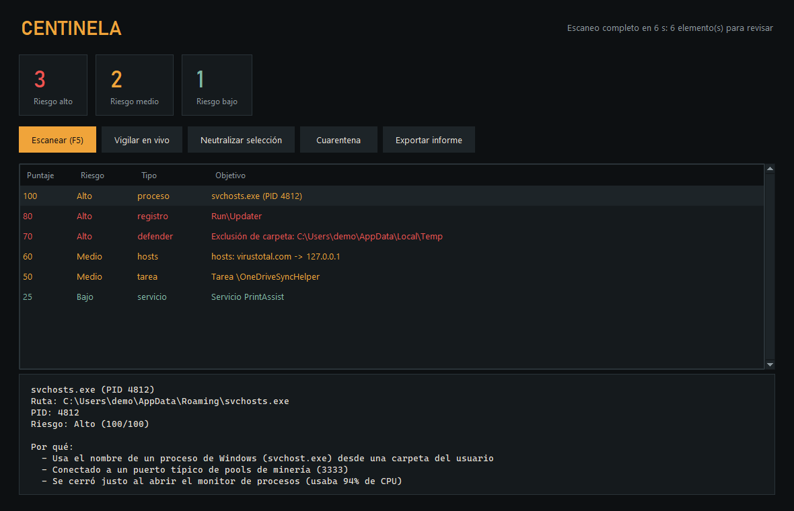

# Centinela

Analizador de amenazas para Windows. Revisa procesos, conexiones, persistencia, Windows Defender y el archivo `hosts`, junta lo que encuentra por programa y le da un puntaje. Lo sospechoso se puede mandar a cuarentena y recuperar después.

Lo armé pensando en mineros de criptomonedas y en el malware común que se instala para arrancar con Windows.



<sub>La captura usa datos de demostración, no un escaneo real.</sub>

## Qué revisa

- **Procesos**: binarios de sistema que corren desde carpetas del usuario, padres que no corresponden (un `svchost.exe` que no lanzó `services.exe`, o un PowerShell abierto por Word o por el navegador), nombres y argumentos típicos de mineros y abuso de PowerShell o de otros intérpretes de scripts.
- **Red**: conexiones a puertos que usan los pools de minería.
- **Persistencia**: claves Run, Winlogon e IFEO del registro, carpetas de Inicio, tareas programadas, servicios y suscripciones WMI. La firma de cada ejecutable se verifica con PowerShell.
- **Defender**: protección en tiempo real o contra alteraciones apagada, y exclusiones de carpetas, procesos o extensiones.
- **hosts**: dominios de Microsoft, de antivirus o de GitHub redirigidos a otra parte.
- **Modo vigilancia**: algunos mineros se frenan cuando abrís el Administrador de tareas. Centinela mide la CPU antes y después de abrir un monitor de procesos y marca a los que se cierran o se calman de golpe.

Cada hallazgo suma puntos con su motivo y la suma decide la severidad del programa, así el informe muestra pocas entradas con el porqué de cada una en lugar de una lista larga de alertas sueltas.

## Usarlo

Necesita Windows y Python 3.11 o más nuevo.

```bash
pip install -e .[dev]
centinela             # interfaz gráfica
centinela --report    # informe en la consola
```

Para revisar servicios, tareas de otros usuarios y la cuarentena conviene correrlo como administrador. La cuarentena vive en `%ProgramData%\Centinela\cuarentena` y guarda lo necesario para restaurar cada archivo o valor de registro.

## Ejecutable

```bash
python build.py
```

Arma `dist/Centinela.exe` con PyInstaller. GitHub Actions corre los tests y compila el ejecutable en Windows en cada push.

## Tests

```bash
python -m pytest
```

Los escáneres reciben los datos ya recolectados, así que los tests usan fábricas de procesos, conexiones y entradas de inicio falsas y no necesitan tocar el sistema real.
